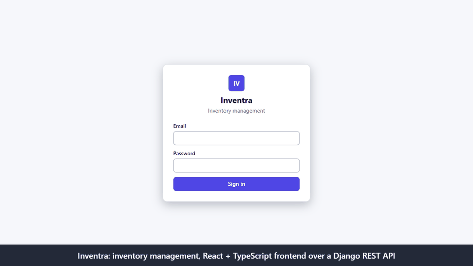
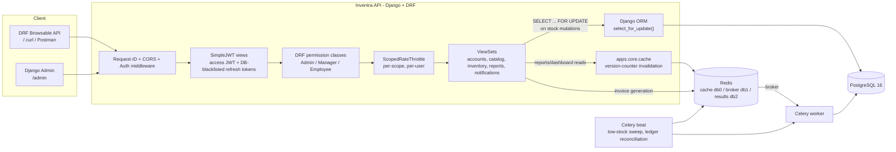
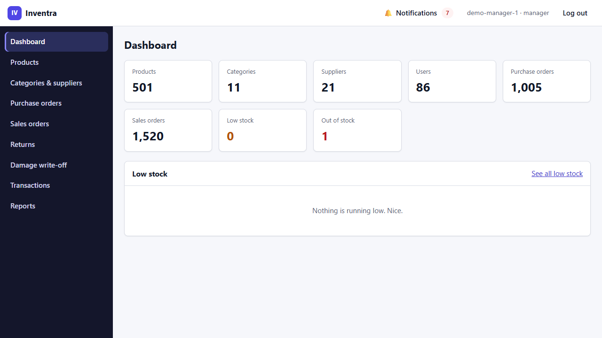
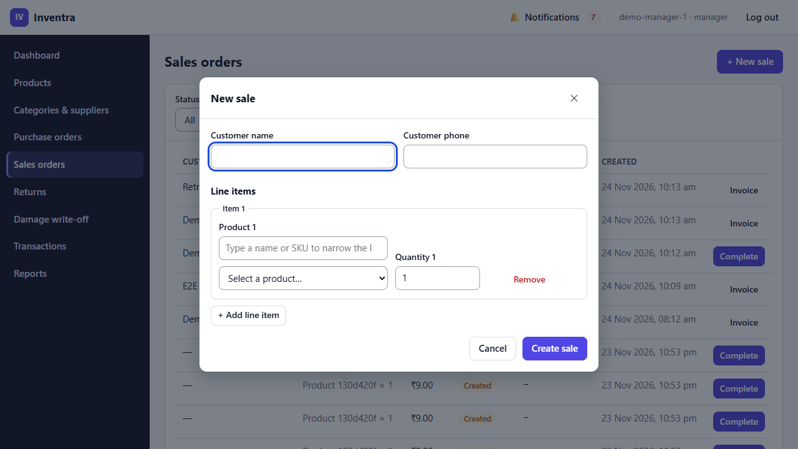
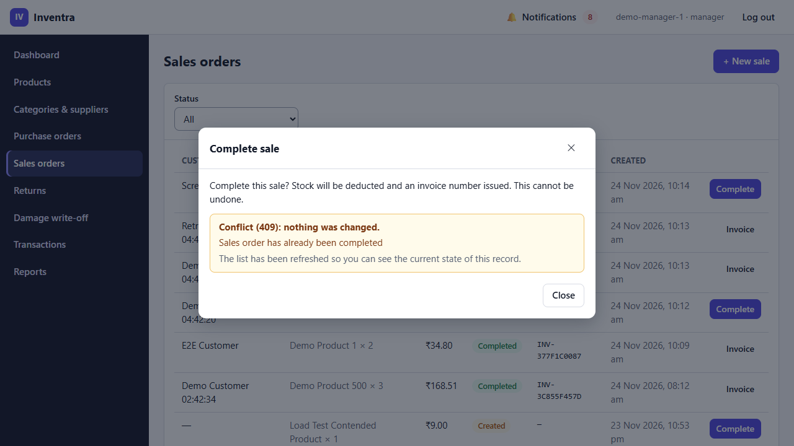
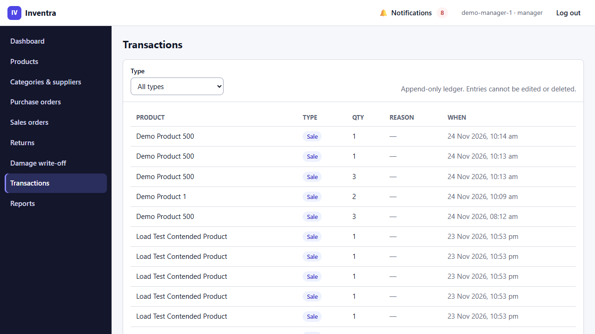
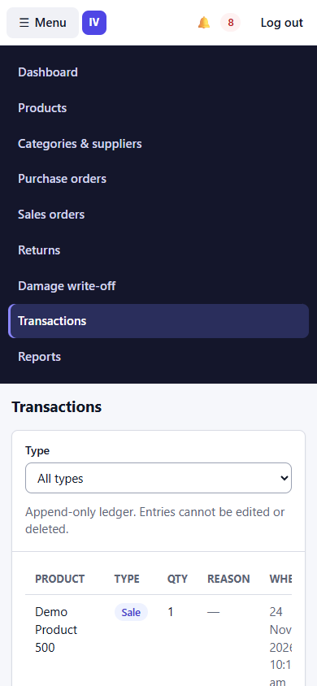

# Inventra


**Locked: 100 sales against 100 units of stock, stock dropped by exactly 100. Unlocked, same test: 143 to 198 sales recorded but stock only dropped by 3 to 5, so 138 to 195 sales silently lost, with zero HTTP errors on the unlocked path.**

That's the headline from Phase 6's load test, not a claim. Concurrent requests hitting the same product without row-level locking don't fail loudly, they corrupt the ledger silently: the response looks like a success, the invoice gets issued, and the stock count just quietly stops matching the sales it recorded. Full numbers, the mechanism, and how to reproduce it: [Performance](#performance) below, full writeup in [docs/v2/LOAD_TEST_RESULTS.md](docs/v2/LOAD_TEST_RESULTS.md).



*Demo: login, a sale that deducts stock, a retried completion answered with a 409, the append-only ledger, and the recorded locked vs unlocked load-test results. The [full video](docs/demo/inventra-demo.webm) is in the repo and `docs/demo/record.mjs` regenerates it against a local `docker compose up`.*

Inventory management backend for a single-warehouse, single-currency retailer, built on Django 5 + Django REST Framework: products, suppliers, purchase orders, sales orders, returns, and a stock movement ledger that's never edited or deleted, behind role based JWT auth. This branch (`v2`) is the full build: caching, background jobs, rate limiting, structured logging, the load-test evidence above, plus a React + TypeScript frontend. See the [`v1`](https://github.com/tharunsridhar/Inventra/tree/v1) branch for the same backend, API only, no frontend.

- Products, suppliers, purchase orders, sales orders, returns, damage write offs
- Append only stock ledger, enforced twice (no write route, and the Admin can't edit or delete it either)
- Role based JWT auth, rate limited per scope
- Redis-cached reports, Celery background jobs (async invoices, low-stock alerts, nightly ledger reconciliation)
- Structured JSON logging with one request id traced across the web process and any worker task it dispatches

📘 **API docs:** Swagger UI at `/api/docs/` (OpenAPI schema at `/api/schema/`), DRF's browsable API at any endpoint (e.g. `/products`), `/admin` for the Django Admin

## Performance

Measured on a single local dev machine (not production hardware, see [docs/v2/LOAD_TEST_RESULTS.md](docs/v2/LOAD_TEST_RESULTS.md) for the exact specs and every caveat), 40 concurrent users (spawn rate 40, 20 s per run, Django dev server on the host, Postgres in Docker) hitting `/sales-orders/{id}/complete` against one product with 100 units of stock. Two runs per mode, run on 2026-11-23:

| Locking | Run | Sold | Stock actually dropped by | Discrepancy | Req/s | p50 | p95 | HTTP errors |
|---|---|---|---|---|---|---|---|---|
| OFF | 1 | 198 | 3 | **195 lost updates** | 23.4 | 420 ms | 6500 ms | 0 |
| OFF | 2 | 143 | 5 | **138 lost updates** | 19.2 | 1000 ms | 6300 ms | 0 |
| ON | 1 | 86 | 86 | **0** | 19.6 | 1500 ms | 4900 ms | 0 |
| ON | 2 | 100 | 100 | **0** | 30.5 | 970 ms | 4400 ms | 139 (all 409, after sell-out) |

- Req/s, p50 and p95 are aggregated across all requests in the scenario.
- The 409s in locked run 2 are correct refusals once stock hit 0. They are not failures.
- The unlocked path sells more units than exist (143 and 198 against 100) and almost none of those sales reach the stock count.
- Exact loss numbers vary a lot from run to run. Only the locked result (0 lost) is stable.
- An earlier run on slower hardware (2026-09-08) showed 66 sold, 50 dropped, 16 lost unlocked and 78 sold, 78 dropped locked. Same mechanism, smaller loss. See [docs/v2/LOAD_TEST_RESULTS.md](docs/v2/LOAD_TEST_RESULTS.md).
- Throughput numbers come from a single-process dev server on a laptop. Read them as relative, not as capacity.

The unlocked rows show zero HTTP errors. That's the point: the unlocked path doesn't fail, it silently loses updates under READ COMMITTED, since two concurrent transactions can both read the same pre-decrement stock value before either commits. `select_for_update()` closes that window by making the second transaction's read wait for the first to commit, then re-read the already-updated value.

- Full results, the analysis, and how to reproduce both rows on demand: [docs/v2/LOAD_TEST_RESULTS.md](docs/v2/LOAD_TEST_RESULTS.md)
- Same test over public HTTPS (the local docker stack behind a Cloudflare tunnel, not a hosted deployment; 40 users, 30 s, locking on): 100 units sold, stock dropped by exactly 100, 51 req/s aggregated, p50 640 ms, p95 1500 ms, zero 5xx. The 412 failures Locust reports were 344 correct 409 refusals after sell-out and 68 rate-limit 429s. Details and caveats: [docs/v2/DEPLOYED_LOAD_TEST.md](docs/v2/DEPLOYED_LOAD_TEST.md)
- Locking tradeoff writeup: [docs/v2/adr/0003-locking-tradeoff.md](docs/v2/adr/0003-locking-tradeoff.md)
- Cache effectiveness (Phase 2, proven via query counts, not just timing): report/dashboard endpoints go from 9/2/3 queries to 1 on a cache hit, verified directly with `CaptureQueriesContext` in `tests/test_caching.py`

## Architecture



## Tech stack

- Django 5, Django REST Framework
- PostgreSQL 16 (psycopg v3), Django ORM migrations
- djangorestframework-simplejwt (access JWT + DB blacklisted refresh tokens)
- django-filter
- Redis, django-redis (cache), Celery (background jobs, periodic schedule via `CELERY_BEAT_SCHEDULE`, no separate scheduler package)
- structlog (structured JSON logging in production, colored console in dev)
- reportlab (invoice PDF generation)
- locust (load testing, dev dependency only)
- whitenoise for static files
- pytest + pytest-django
- Docker, GitHub Actions

Also includes a React + TypeScript frontend (Vite, TanStack Query, Vitest). See the [Frontend](#frontend) section below.

## Frontend

A React + TypeScript single page app in [frontend/](frontend/), built with Vite. It uses the same REST API as everything else here, with no backend changes beyond the OpenAPI schema it is typed from.



| | |
|---|---|
|  |  |
|  |  |

**Run it**
- Docker: `docker compose up --build`, then open http://localhost:3000. nginx serves the build and proxies `/api` to Django, so the browser sees one origin and CORS never comes into it
- Dev server: `cd frontend && npm install && npm run dev`, then open http://localhost:5173. Vite proxies `/api` to http://localhost:8000 (set `VITE_API_TARGET` to point somewhere else)
- Seed the demo users first, see [Quickstart](#quickstart)

**Pages**
- Dashboard: stat cards and a low stock list (Admin, Manager)
- Products: search, stock, category and supplier filters, pagination, create, edit, delete. Filters live in the URL, so a filtered view is linkable
- Categories & suppliers: list, create, delete
- Purchase orders: create with line items, receive with a confirm step
- Sales orders: create with line items, complete with a confirm step, invoice PDF
- Returns: file against a completed sale, approve
- Damage write-off: log a write-off with a reason, see recent ones
- Transactions: the read-only stock ledger with a type filter and pagination
- Reports: product, purchase, sales and inventory reports with a date range, shown as tables
- Users: create, change role, disable and enable, reset password (Admin)
- Notifications: drawer with an unread count and mark as read
- Every list has loading, empty and error states, and errors have a retry button

**Auth**
- Login against `/auth/login`. The access token stays in memory, the refresh token is kept in `localStorage` so a reload keeps you signed in
- A 401 triggers one `/auth/refresh` call, however many requests failed at once, then the original requests are retried
- If the refresh fails the user is sent back to the login form
- Logout calls `/auth/logout` so the refresh token is blacklisted server side

**Role based navigation**
- Employee: Products, Categories & suppliers, Sales orders
- Manager: everything except Users
- Admin: everything
- This mirrors the DRF permission classes (it also hides Purchase orders and Transactions from employees, which the API refuses them anyway). A staff-only URL typed by an employee shows a "not available" page. The real enforcement is the API, so hiding a link never grants or removes access

**409 conflicts**
- Completing a sale, receiving a purchase order and approving a return are guarded server side, so a retried request gets a 409
- The confirm dialog shows that as a distinct "Conflict (409): nothing was changed" notice with the server's own message (already completed, or insufficient stock), removes the confirm button so it can't be fired again, and refreshes the list behind it

**Typed API client**
- The API now serves an OpenAPI schema at `/api/schema/` and Swagger UI at `/api/docs/` (drf-spectacular, the only backend change)
- [frontend/openapi.yml](frontend/openapi.yml) is a snapshot of that schema. `npm run gen:api` turns it into [frontend/src/api/schema.d.ts](frontend/src/api/schema.d.ts)
- Refresh the snapshot after an API change: `uv run python manage.py spectacular --file frontend/openapi.yml`, then `npm run gen:api`
- The dashboard, reports, damage and task status views are plain `APIView`s with no serializer, so the schema can't describe them. Their response types are written by hand in [frontend/src/api/types.ts](frontend/src/api/types.ts)

**Tests and checks**
- `npm test`: Vitest and React Testing Library with MSW standing in for the API. Covers login, token refresh and logout, role based navigation, creating a sale, and the 409 cases
- `npm run lint` (ESLint with jsx-a11y), `npm run typecheck` and `npm run build` also run
- All four run as the `frontend` job in [.github/workflows/ci.yml](.github/workflows/ci.yml)

**Accessibility and small screens**
- Every input has a label, errors are tied to their field, dialogs trap focus and return it on close, Escape closes them, and there is a skip link
- Toasts and the notification count are announced through live regions
- The sidebar collapses behind a Menu button on phones and wide tables scroll sideways inside their panel

**Stack**
- React 19, TypeScript (strict), Vite, React Router, TanStack Query
- Plain CSS, no component library
- Orders, returns and the ledger carry product ids only, so names come from a cached product index. The product pickers search the API as you type, so they work at any catalog size

## Key engineering decisions

**Immutable transaction ledger, enforced twice.**
- `InventoryTransactionViewSet` is a `ReadOnlyModelViewSet`. There's no create/update/delete route registered for it at all, enforcing an immutable ledger at the routing layer.
- A second, independent enforcement point backs that up: `InventoryTransactionAdmin` hard disables `has_add_permission`, `has_change_permission`, and `has_delete_permission`, so even a superuser in the Django Admin can't edit or delete a ledger row. See [apps/inventory/admin.py](apps/inventory/admin.py).

**Idempotency guarantees.**
- `POST /purchase-orders/{id}/receive` and `POST /sales-orders/{id}/complete` can be called more than once safely.
- The first call transitions `ordered -> received` (or `created -> completed`) and applies the stock change.
- Every call after that sees the new status and returns `409 Conflict` with zero side effects, logged as `idempotent_replay_409` (see [Structured logging](#structured-logging)).

**Row level locking, with the cost measured, not assumed.**
- The idempotency check is only race free if two concurrent `/receive` calls on the same order can't both read `status="ordered"` before either commits.
- Every stock mutation takes `select_for_update()` on the order row and each affected product row, locked in a fixed id sorted order, so transactions touching the same products queue up instead of deadlocking.
- See [Performance](#performance) above for what removing this actually does under real concurrent load, and [apps/inventory/views.py](apps/inventory/views.py) / [tests/test_concurrency.py](tests/test_concurrency.py) for the proof with real concurrent HTTP requests.

**Cache invalidation via version counters, not key enumeration.**
- Reports and dashboard responses are cached (Redis, 300s TTL), keyed by a per-namespace version integer rather than individual key deletion.
- Every stock mutation bumps the version from inside `transaction.on_commit(...)`, never inline, so a rolled-back mutation can never invalidate the cache on the basis of a change that didn't happen.
- Full rationale: [docs/v2/adr/0001-cache-invalidation.md](docs/v2/adr/0001-cache-invalidation.md).

**Structured logging with one request id across process boundaries.**
- Every log line is fields (`logger.info("stock_mutation", order_id=..., actor_id=..., lock_wait_ms=...)`), not a formatted sentence.
- A request id, generated or read from `X-Request-ID`, is bound into every log line for a request and propagated into any Celery task it dispatches, so one id traces web to queue to worker.
- Real captured example, both processes: [docs/v2/LOG_SAMPLE.md](docs/v2/LOG_SAMPLE.md). Rationale: [docs/v2/adr/0004-request-tracing.md](docs/v2/adr/0004-request-tracing.md).

**Revocable refresh tokens.**
- `djangorestframework-simplejwt`'s `token_blacklist` app records every rotated out refresh token in the database, so a stolen or logged out token can be rejected immediately rather than trusted until it naturally expires.
- `ROTATE_REFRESH_TOKENS` + `BLACKLIST_AFTER_ROTATION` record every rotated out token, and `POST /auth/logout` blacklists the current one, so `/auth/refresh` rejects it immediately afterward.

## Quickstart

```bash
cp .env.example .env
docker compose up --build
```

Starts postgres, redis, the api, a Celery worker, Celery beat and the React frontend. The app is at **http://localhost:3000** (nginx serves the build and proxies `/api` to Django). The API is at **http://localhost:8000**:
- `/api/docs/`: Swagger UI for the whole API (`/api/schema/` is the raw OpenAPI schema)
- `/app`: the previous plain HTML/JS frontend, still served by Django for now
- `/admin`: Django Admin (create a superuser first, see below)
- any resource path, e.g. `/products`: DRF's browsable API (HTML form + JSON, no separate client needed)
- `/health`: reports database, redis, and celery status (the last one pings the actual worker)

Migrations and `collectstatic` run automatically on container start (see `docker-entrypoint.sh`), before `gunicorn` boots.

**Creating an admin user** (no seed script needed for this, Django ships it for free):

```bash
docker compose exec api python manage.py createsuperuser
```

**Seeding demo data** (for exploring the API or re-running the load test locally):

```bash
docker compose exec api python manage.py seed_demo --products 500 --orders 2000
```

Demo logins created by the seed (all use the password `demopass123`):

| Role | Email |
|---|---|
| Admin | `demo-admin@demo.seed` |
| Manager | `demo-manager-1@demo.seed` (also `demo-manager-2`) |
| Employee | `demo-employee-1@demo.seed` (also `-2`, `-3`) |

Note: compose binds Postgres to host port 5432. Stop any local Postgres first, or the stack won't start.

**Running on the host instead of Docker:**

```bash
uv sync
cp .env.example .env   # point DATABASE_URL/REDIS_URL at services you can reach
uv run python manage.py migrate
uv run python manage.py createsuperuser
uv run python manage.py runserver
# separately, for background jobs:
uv run celery -A config worker --loglevel=info
uv run celery -A config beat --loglevel=info
```

## Running the tests

```bash
uv sync
cp .env.example .env   # DATABASE_URL/REDIS_URL just need to point at reachable services
uv run pytest -v
```

- pytest-django creates its own `test_<database>` database against that same Postgres server, runs every migration against it, and drops it when the session ends. No SQLite stand-in.
- `config/settings/test.py` points the cache and Celery result backend at in-process backends (`LocMemCache`, `cache+memory://`), so the suite needs no real Redis and `CELERY_TASK_ALWAYS_EAGER=True` runs tasks inline with no broker or worker required.
- Most tests use the `db` fixture, wrapping each test in a transaction rolled back afterward. A handful (the two concurrency tests, one caching test, one task test) opt into `django_db(transaction=True)` since they need real commits: `transaction.on_commit(...)` callbacks and `live_server`'s cross-connection visibility both require it.

31 tests: role based access control, the atomic/idempotent transaction guarantee, cache hit/miss/isolation/rollback-safety, throttling, Celery task correctness (including the on-commit-gates-dispatch guarantee), and 2 real concurrency tests against a `live_server`.

## Deployment (optional)

Inventra is not deployed anywhere. It runs locally with `docker compose up --build` (see [Quickstart](#quickstart)). If you want to host it yourself:

- Containerized, deploys to [Railway](https://railway.app) from the Dockerfile directly (see `railway.json` for the api service).
- The worker and beat processes are separate Railway services from the same repo with an overridden start command, plus a Redis plugin. Full setup: [docs/v2/DEPLOY.md](docs/v2/DEPLOY.md).
- Every required environment variable is documented in [.env.example](.env.example).
- `/health` reports database, redis, and celery status and backs Railway's own healthcheck.

## Roles & permissions

- **Admin**: full access, including user management, via both the API and the Django Admin.
- **Manager**: products, suppliers, categories, purchases, sales, approves returns, logs damage, views reports/dashboard.
- **Employee**: views products/inventory, creates and completes sales orders only.

## Core business flow

```
Supplier → Purchase Order (ordered) → /receive → Product.current_stock +=
Customer → Sales Order (created)    → /complete → Product.current_stock -=
Sales Order (completed) → Return (pending) → Manager /approve → Product.current_stock +=
Manager/Admin → Damage write-off (reason required) → Product.current_stock -=
```

## API overview

- `auth`: `/auth/register`, `/auth/login`, `/auth/refresh`, `/auth/logout` (blacklists the refresh token), `/users/me`
- `users` (Admin only, `/users`): CRUD via `UserViewSet`
- `categories`, `suppliers`, `products`: CRUD + soft delete; products support search/filter/ordering via `django-filter`
- `purchase-orders`: create, update (pre-receive only), `/receive` (locked, idempotent)
- `sales-orders`: create, update (pre-complete only), `/complete` (locked, idempotent), `/invoice` (async, 202 + task id)
- `returns`: create (reservation locked against the parent sales order), `/approve` (Manager/Admin, locked)
- `damage`: write-off (Manager/Admin, reason required, locked)
- `inventory-transactions`: read-only audit trail, filterable by product/type/date range
- `dashboard`, `reports/products`, `reports/purchases`, `reports/sales`, `reports/inventory`: cached, aggregate views, date-range filterable
- `notifications`: per-user, filterable by unread, mark-as-read
- `tasks/{id}`: poll status of an async task (currently invoice generation)

## Project structure

```
apps/
  accounts/     - custom User (role as a TextChoices field, not a lookup table), JWT auth, permissions.py
  catalog/      - Category, Supplier, Product; seed_demo and load-test management commands
  core/         - cache.py, throttling.py, middleware.py, celery_signals.py, exceptions.py, checks.py - cross-cutting v2 infra
  inventory/    - PurchaseOrder(+Item), SalesOrder(+Item), InventoryTransaction ledger, Return, tasks.py
  reports/      - no models - aggregation views only, cached
  notifications/- Notification, per-user create/list/mark-read
config/
  settings/     - base.py / development.py / production.py / test.py
  celery.py     - Celery app, imported from config/__init__.py
  urls.py       - route table, /health, /tasks/{id}
frontend/       - React + TypeScript app (Vite), its Dockerfile and nginx.conf, Vitest suite, openapi.yml snapshot
loadtest/       - locustfile.py + how to run it (see docs/v2/LOAD_TEST_RESULTS.md)
docs/v2/        - CURRENT_STATE.md, LOAD_TEST_RESULTS.md, LOG_SAMPLE.md, DEPLOY.md, adr/
tests/          - pytest-django suite (see "Running the tests" above)
Dockerfile, docker-compose.yml, railway.json - see Quickstart / Deployment
.github/workflows/ci.yml - postgres + redis services, migrations + pytest + ruff, plus a frontend job (lint, typecheck, Vitest, build), on every push/PR
```

Five apps, not eleven. `inventory` groups PurchaseOrder/SalesOrder/Return/InventoryTransaction together deliberately, since they're all tightly coupled around the one stock ledger. `core` isn't a Django app (no models) - just where the v2 cross-cutting infrastructure (caching, throttling, request tracing, the locking-kill-switch guard) lives, since none of it belongs to one domain app.

## Deferred

Multi-warehouse support, partial PO receiving, PO approval workflow, supplier returns, email based password reset/notifications, file storage beyond local disk for generated PDFs (a real multi-instance deployment needs shared/object storage, see `config/settings/base.py`'s `MEDIA_ROOT` comment). Everything else on the original "deferred to v2" list (rate limiting, structured logging, Redis caching, background jobs, PDF invoices) is now implemented, see the sections above.

<!-- last updated: 2026-11-11 -->
